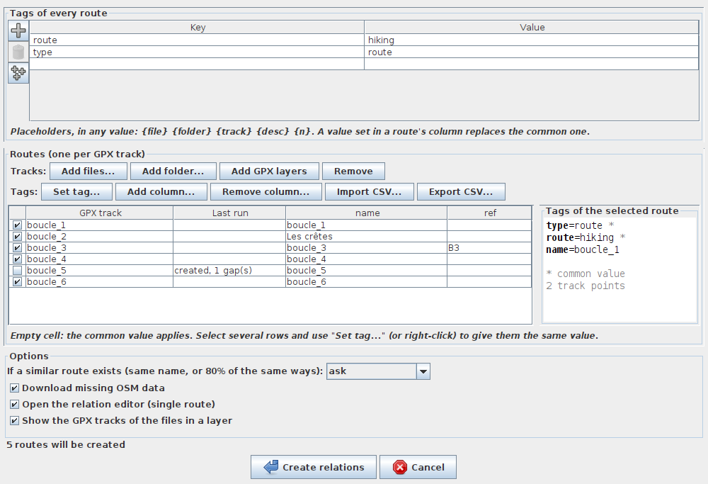

# routefromgpx: JOSM plugin

Creates OpenStreetMap **route relations** (`type=route`, `route=hiking|bicycle|mtb|horse|...`)
from GPX tracks: one track, several files, or a whole folder. The relations are built
inside JOSM, on the data you have downloaded, and nothing is uploaded until you upload it
yourself.

For each track, the plugin:

1. downloads the OSM data along the track, if the data layer doesn't cover it yet. Long
   tracks are downloaded in boxes along the track;
2. **map-matches** the track on the ways of the data layer, without any routing server, so
   the result reflects the current data, including your unsaved edits;
3. **splits** the ways the track only partly uses, with JOSM's split command, which keeps
   other relations consistent;
4. adds the relation, with its members in travel order and your tags;
5. reports **gaps** (stretches of track with no way under it, usually a path missing from
   OSM) and **similar existing routes** (same name, or 80% of the same ways).

## Usage

*Tools → Route relations from GPX…* opens the dialog. If the active layer is a GPX
layer, its tracks are already in the list.



- **Tracks**:
  - *Add files…*, *Add folder…* (optionally with sub-folders) and *Add GPX layers*
    fill the table, with one row per GPX track (`<trk>`, all segments joined) or route
    (`<rte>`);
  - untick a row to skip it.
- **Tags of every route**: the common tags, in JOSM's tag editor with auto-completion.
  They are remembered between sessions. The default is `type=route`, `route=hiking`.
  - *Suggested tags* lists the usual route keys (`route`, `network`, `operator`, `ref`,
    `distance`, `ascent`, `descent`, `roundtrip`, `colour`, `osmc:symbol`, `source`, `state`...)
    with their usual values (e.g. `route=hiking|bicycle|mtb|...`, `network=iwn|nwn|rwn|lwn|icn|...`,
    `source=survey|GPS|gpx`). Its first entry adds `distance={distance}`, `ascent={ascent}` and
    `descent={descent}`, computed from each track.
  - The same values are offered by the editor's auto-completion.
- **Per-route tags**: one table column per tag key.
  - An empty cell means the common value applies; a value in a cell replaces it.
  - The `name` column starts with the GPX track name, or the file name if the track
    has none.
  - *Add column…* / *Remove column…* manage the columns.
  - Select several rows, then *Set tag…* (or right-click) to give them all the same
    value.
  - Cells and *Set tag…* offer the usual values of the key, plus those already used in
    the column.
- **Placeholders**, in any value, common or per route:

  | Placeholder | Value |
  |---|---|
  | `{file}` | GPX file name without `.gpx` (or the layer name) |
  | `{folder}` | name of the folder holding the file |
  | `{track}` | `<name>` of the track |
  | `{desc}` | `<desc>` of the track |
  | `{n}` | position of the track in its file |
  | `{distance}` | length of the track in km, one decimal |
  | `{ascent}` / `{descent}` | total climb / descent in metres, from the GPX `<ele>` (changes under 5 m are ignored as noise); empty if the track has no elevation |

  For example, `ref={file}` or `operator=Club {folder}`. A tag whose value ends up
  empty (e.g. `description={desc}` for a track without a description) is not written.
- **Preview**: the right-hand panel shows the final tags of the selected route. Common
  values are marked with `*`, and problems (no `route=*`, unknown placeholder, value over
  255 characters) are shown in red. *Create relations* refuses to start until they are
  fixed.
- **Options**:
  - when a similar route exists: *skip the track*, *create it anyway* or *ask*;
  - download missing data;
  - open the relation editor when a single route was created;
  - show the tracks of the files in a GPX layer.

After the run, a **results** window lists every track: created or not and why, members,
split ways, gaps, the share of track points matched, and warnings.

- Selecting a row selects the relation (or the similar route) and zooms to it.
- Double-click a row, or click *Relation editor*, to open the relation in the editor.
- The gaps are also put in a "Gaps" GPX layer. If the path exists, draw it along the
  track, connect both ends and add it to the relation at the given position.

The list of tracks and their tags is kept for the JOSM session. Created rows are
unticked and their result is shown in the *Last run* column, so you can reopen the
dialog to fix and rerun the others.

Each split and each relation is a separate undo step.

### Tags from a CSV file

*Import CSV…* reads per-route tags from a CSV file:
- the `file` column (required) holds the GPX file name, with or without `.gpx`;
- the optional `track` column holds the track number or name, for files with several
  tracks;
- every other column is a tag key.

The file is UTF-8, and the separator (`,`, `;` or tab) is detected automatically.

```csv
file;ref;name;distance
boucle_01.gpx;B1;Boucle des crêtes;12.4
boucle_02;B2;Tour du lac;
```

- When you add a folder that contains a `tags.csv`, it is imported automatically.
- *Export CSV…* writes the table in the same format, so you can edit it in a
  spreadsheet and import it back.
- CSV rows that match no track are reported.

## Matching

The matcher is a hidden Markov model (Newson & Krumm 2009) solved with Viterbi.
- **Candidate ways**: the ways of the data layer that the route type may use (see below).
  For each track point, the candidates are its projections on way segments within 50 m.
- **Scoring**: the distance to the point (σ = 10 m) is balanced against the difference
  between route length and straight-line distance (β = 10 m). Routes are found with
  Dijkstra on the ways.
- **Gaps**: where no route links two points, or the track runs more than 25 m from the
  ways over at least 50 m, the stretch is reported as a gap rather than snapped to a
  detour.
- **Spurs**: short out-and-back spurs caused by GPS noise (under 25 m, or under 100 m
  when they turn back in the middle of a way) are dropped.

| `route=*` | Ways used | Same kind (duplicate check) |
|---|---|---|
| `hiking`, `foot`, `walking` | `highway=*`, `foot=*` decides | hiking, foot, walking |
| `running` | as hiking | running |
| `bicycle`, `mtb` | `highway=*` except steps; `bicycle=*`, then `vehicle=*` | bicycle, mtb |
| `horse` | `highway=*` except steps; `horse=*` | horse |
| `inline_skates` | `highway=*` except steps, tracks, paths; `inline_skates=*` | inline_skates |
| any other value | as hiking | itself |

These ways are never used: motorways, construction, `area=yes`, `access=no|private`
(unless the mode's own key allows it) and `motorroad=yes`.

## Build, test, install

You need a JDK (17 or later) and JOSM. There is no Ant or Gradle: the build compiles
against the installed `josm.jar`.

```sh
./build.sh            # dist/routefromgpx.jar
./build.sh test       # build, then run the headless checks in test/
./build.sh install    # build, then copy the jar to ~/.local/share/JOSM/plugins/
```

You can override `JOSM_JAR` (default `/usr/share/josm/josm.jar`), `JOSM_PLUGIN_DIR` and
`VERSION` (default `git describe`). After installing, enable *routefromgpx* in
*Preferences → Plugins* and restart JOSM.

Tests (`test/`, plain `main` methods, run headless):

- `PluginCheck`: tag templates, CSV reading and writing, GPX reading, and the whole
  pipeline (match, plan, split, relation) on a synthetic data set;
- `RouteProfileCheck`: the access rules and download boxes;
- `core/LocalMatcherCheck`: the matcher on synthetic ways (junctions, out-and-backs,
  gaps, noise).

The dialogs themselves have only been tested by hand.

## Code

| Package / class | Role |
|---|---|
| `core.LocalMatcher` | HMM map matcher, pure Java |
| `core.RoutePlanner` | matching → ordered way segments, cut nodes, gaps, quality, overlaps; pure Java |
| `core.RouteBuilder` | plan on a JOSM `DataSet`, then apply (`SplitWayCommand`, `AddCommand`) |
| `core.RouteProfile` | per `route=*` type: usable ways, related types |
| `GpxTracks`, `TrackSource` | GPX files/folders/layers → tracks |
| `TagTemplate`, `CsvTags` | tag merging, placeholders, CSV |
| `RoutesDialog`, `TrackTableModel` | the main dialog |
| `BatchTask` | download, match, build, one track after the other |
| `ReportDialog` | results window |

## Publishing

To publish the plugin, the JOSM plugin list needs the jar at a stable URL:

1. Tag a version and build it with `VERSION=<n> ./build.sh`. `Plugin-Version` is
   `git describe` by default. `Plugin-Mainversion` (the oldest supported JOSM version)
   is set in `build.sh`.
2. Publish the jar, for example as a GitHub release asset.
3. Add the jar URL to the [JOSM plugin sources list](https://josm.openstreetmap.de/wiki/PluginsSource),
   and write the wiki page given in `Plugin-Link`
   (`https://wiki.openstreetmap.org/wiki/JOSM/Plugins/routefromgpx`).

The texts already go through `I18n.tr()`, so the plugin can be translated.

Creating many relations at once from an external source is an import: follow the
[Import guidelines](https://wiki.openstreetmap.org/wiki/Import/Guidelines) and the
[Automated Edits code of conduct](https://wiki.openstreetmap.org/wiki/Automated_Edits_code_of_conduct),
and check the data source's licence.

## License

GPL v2 or later (see `LICENSE`), like JOSM.
